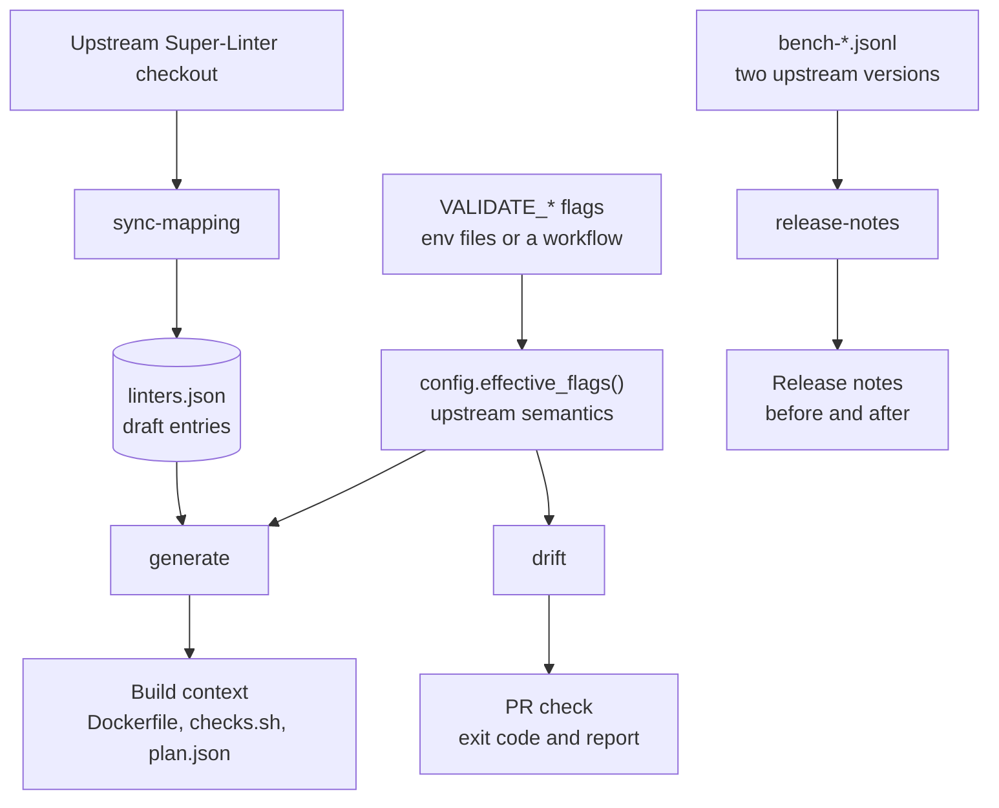
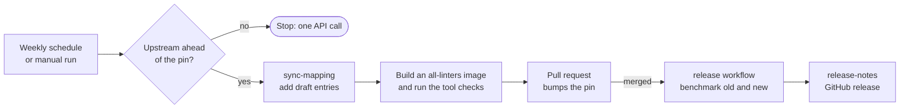

# Architecture

## Overview

`superlint-lean` generates lean Super-Linter images and guards the pull requests
that would outgrow them. Every command starts from the same input: the
`VALIDATE_*` flags of a repository, resolved with upstream's semantics.

`generate` and `drift` start from the flags of the repository. `sync-mapping` starts
from an upstream checkout and keeps `linters.json`, which `generate` reads, complete.
`release-notes` starts from benchmark results.

### Following upstream

Nothing runs for upstream unless it has published a newer release than the one pinned
in `upstream-version.txt`.

## Modules

| Module | Responsibility |
| :--- | :--- |
| `cli.py` | Dispatches `generate`, `drift`, `sync-mapping`, `release-notes`, `bench`, `compare`, `summarize`, `repository-settings`, `select-upstream` and `smoke`; prints usage and the version. |
| `config.py` | Parses env files and workflows; `effective_flags` implements the upstream `VALIDATE_*` rules. |
| `generate.py` | Turns the selected flags plus `data/linters.json` into `Dockerfile`, `checks.sh`, `plan.json`. |
| `drift.py` | Maps changed files to flags with `data/filetypes.json` and reports files no enabled linter covers. |
| `mapping_sync.py` | Reads an upstream checkout and adds draft entries to `linters.json` for new flags. |
| `release_notes.py` | Compares `bench-*.jsonl` results of two upstream versions into Markdown release notes. |
| `bench.py` | Times `docker pull` (cold: after clearing every unused image; warm: image present) and container start, and writes one JSON row per run. |
| `report.py` | Turns `bench-*.jsonl` and `build-*.jsonl` into the Markdown tables of `compare` (lean against baseline, per profile) and `summarize` (one row per variant). |
| `repository_settings.py` | Holds the repository settings (merge options, Actions permissions, the default-branch ruleset) as data and sends them with `gh api`. |
| `upstream.py` | Picks the upstream release to sync to: the newest published one that is at least the cooldown old, and whether the pin is behind it. |
| `smoke.py` | Runs a built image on upstream's good and bad fixtures, one linter at a time, and reports the outcome. |

## Data

- `linters.json` maps each upstream flag to what it needs: binaries, directories, virtualenvs, npm groups, apk packages, links, environment and tool checks. It must cover every flag of the version pinned in `upstream-version.txt`.
- `filetypes.json` holds the file type rules transcribed from upstream, so `drift` can tell which linters would lint a file.

## Workflows

| Workflow | Purpose |
| :--- | :--- |
| `tests.yaml` | Lint, type-check, test with coverage, build. |
| `super-linter.yaml` | Super-Linter on pull requests and pushes to `main` (managed by ghwm). |
| `pr-title-check.yaml` | Conventional commit PR titles. |
| `auto-assign-pr.yaml` | Assigns the author to new pull requests (managed by ghwm). |
| `auto-release.yaml` | Tags a version and publishes a release when `src/` or `pyproject.toml` change on `main` (managed by ghwm). |
| `upstream-sync.yaml` | Detects a newer upstream release (at least `UPSTREAM_COOLDOWN_DAYS` old, repository variable, default 0); only then syncs the mapping and opens a bump pull request. |
| `release.yaml` | On a bump of the pin: benchmarks old and new versions and publishes a release. |
| `profiles.yaml` | Reusable benchmark per stack profile. |
| `self-image.yaml` | Builds this repository's own lean Super-Linter image from `.github/super-linter.env` with the composite action (`action.yml`: generate, build, smoke test) and pushes it to GHCR (`ghcr.io/<owner>/<repo>/super-linter-lean`), signs it with cosign and attaches build provenance ([verify](verifying-images.md)). |
| `drift-blocker.yml` | Reusable workflow other repositories call to run `drift`. |

## Managed workflows

`super-linter`, `auto-assign-pr` and `auto-release` come from the ghwm registry
and are declared in `ghwm.yml`; `ghwm.lock` records the installed files. Update
them with `ghwm upgrade` rather than editing the workflow files. Their config
files (`.github/super-linter.env`, `.github/linters/`, `.github/auto_assign.yaml`,
`.github/auto-release.yaml`) are this repository's own settings: ghwm creates them
once and leaves them alone afterwards. The remaining workflows are specific to this
repository.

The registry also has a `super-linter-lean` workflow that builds, scans and publishes
the lean image, and `super-linter` 2.0.0 can run it through `SUPER_LINTER_CUSTOM_IMAGE`.
See [using-with-ghwm.md](using-with-ghwm.md).

## Design principles

- Nothing that follows upstream runs unless upstream has a newer release.
- Everything stays configurable; the base and toolchains are examples.
- Untrusted input (changed files, workflows) is read, never executed.

## Smoke test

`superlint-lean smoke <image> <plan.json> <upstream-dir>` checks that a built image still lints. For every flag in
`plan.json` it runs the image with only that linter enabled, once on the good files and once on the bad files
of Super-Linter's `test/linters/<flag>` fixtures, taken from a checkout at the pinned tag (MIT licensed, so
they are read, not copied). The verdict comes from the Super-Linter summary, so a linter that found no files
does not count as a pass. Flags without a fixture are reported, not failed. Upstream's own `TEST_CASE_RUN`
mode cannot be used because it refuses to run unless every validation is enabled.

The fixtures are copied to a work directory that the containers mount. It lives under `RUNNER_TEMP` when that is set
(GitHub Actions), because the Docker daemon of a self-hosted runner does not always see `/tmp`.

It then runs the image once with every flag of the plan enabled, on the bad fixtures of the mapped linters that
are not in the plan, and checks that none of them appears in the summary (disabled linters are skipped).

The smoke test runs in the composite action (`self-image.yaml` and the registry builder), on each benchmark profile
in `profiles.yaml` and on the image with every mapped linter in `upstream-sync.yaml`; its table goes to the job
summary, and the table of the all-linters image goes to the sync pull request.
